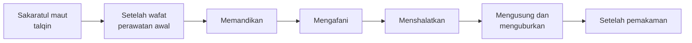

# Pemulasaraan Jenazah: Integrasi Kedokteran dan Keislaman

Mata kuliah Integrasi Keilmuan, Program Studi Pendidikan Dokter (S1)

## Capaian pembelajaran

Setelah sesi ini mahasiswa mampu:

1. Menjelaskan tahapan pengurusan jenazah muslim (talqin, memandikan, mengafani, menshalatkan, menguburkan) beserta hukum dan dalilnya.
2. Membedakan ketentuan yang disepakati dan yang berbeda antar rujukan.
3. Menghubungkan setiap tahap dengan konsep medis: tanda kematian, perubahan pascakematian, kewaspadaan standar, medikolegal, dan etika.
4. Menganalisis kasus nyata di fasilitas kesehatan, termasuk jenazah berisiko infeksi.

## Alur besar

Hukum merawat jenazah muslim (memandikan, mengafani, menshalatkan, menguburkan) adalah **fardhu kifayah**: kewajiban kolektif yang gugur bila sebagian orang telah melaksanakannya.

---

## 1. Sakaratul maut dan perawatan awal

**Orang yang menghadapi sakaratul maut**
- Diingatkan untuk rida, sabar, dan berbaik sangka kepada Allah.
- Ditalkin (dituntun) mengucap *Lā ilāha illallāh*.
- Dianjurkan mengucap kata-kata yang baik.

> Hadis: "Talqinkanlah orang yang akan meninggal di antara kalian dengan *lā ilāha illallāh*." (HR. Muslim no. 2162)

**Kewajiban orang sakit (Tarjih):** sabar, berikhtiar, berprasangka baik kepada Allah, khauf dan raja', serta berwasiat.

**Setelah wafat** (Handbook Raudhatul Jannah dan Tarjih):
1. Memejamkan mata, mendoakan.
2. Merapatkan mulut (mengikat tulang dagu), melemaskan persendian.
3. Menutup seluruh tubuh dengan kain, meletakkan pemberat di perut, membaringkan jenazah.
4. Menghadapkan ke arah kiblat (Tarjih).
5. Menyegerakan perawatan, mengumumkan kepada kerabat, melunasi utang dan melaksanakan wasiat.

---

## 2. Memandikan jenazah

| Aspek | Ketentuan |
|---|---|
| Hukum | Fardhu kifayah |
| Yang memandikan | Muslim, berakal, balig, amanah, paham tata caranya. Prioritas: yang diwasiatkan, ahli waris terdekat, lalu orang lain yang memenuhi syarat |
| Gender | Laki-laki oleh laki-laki, perempuan oleh perempuan, **kecuali suami-istri**. Tarjih menambahkan anak yang belum balig |
| Tempat | Ruang tertutup atau diberi penutup (hijab) agar tidak terlihat orang yang tidak bertugas |

**Wajib (Handbook):** niat karena Allah, menyiram seluruh tubuh secara merata, membaca basmalah.

**Sunah (Handbook):** membungkukkan badan dan mengurut perut, membersihkan kemaluan dengan kain basah, mewudukan, membasuh kepala dengan busa air bidara, memandikan dengan air campuran daun bidara, mulai dari sisi kanan, hitungan ganjil, siraman terakhir dengan air campur kapur barus.

**Tahapan ringkas**
1. Letakkan jenazah di meja pemandian (area tertutup, hanya petugas).
2. Tutup aurat, lalu tanggalkan pakaian.
3. Lemaskan sendi, potong kuku dan kumis.
4. Bungkukkan badan dan tekan perut perlahan, bersihkan kotoran.
5. Wudukan jenazah, basuh kepala (air bidara, busa).
6. Mandikan dari sisi kanan, lalu miringkan ke kiri dan ke kanan untuk membersihkan punggung (Tarjih).
7. Siram merata dengan hitungan ganjil: 3, 5, 7 atau lebih sesuai kebutuhan.
8. Siraman akhir dengan air kapur barus.
9. Keringkan dengan handuk. Rambut perempuan dilepas, dicuci, lalu dikepang tiga (Tarjih).

**Adab petugas:** niat ikhlas, merahasiakan aib jenazah, lembut, memakai sarung tangan, mandi setelah memandikan.

> Hadis: "Barang siapa memandikan jenazah muslim lalu merahasiakan aibnya, Allah mengampuninya empat puluh kali." (HR. Hakim, dalam Tarjih; Baihaqi, dalam Handbook)

**Catatan:** orang yang mati syahid di medan perang tidak dimandikan (Handbook).

---

## 3. Mengafani jenazah

| | Laki-laki | Perempuan |
|---|---|---|
| Jumlah | 3 lembar putih | 5 lembar (Tarjih). Handbook: "ada pendapat" 5 lembar |
| Rincian | Tiga lembar tanpa baju kurung dan serban (hadis Aisyah, HR. Muslim) | Basahan (sarung), baju kurung (gamis), kerudung, dua lembar penutup |

**Persiapan:** kain putih (dibeli dari harta almarhum), tali pengikat, wewangian (parfum, kapur barus), tiga wadah air: air bersih, air bidara, air kapur barus.

**Tata cara ringkas**
1. Bentangkan lembar-lembar kafan bertumpuk, beri wewangian.
2. Pindahkan jenazah ke atas kafan dalam keadaan aurat tertutup.
3. Sejajarkan tangan (di samping pinggang atau bersedekap di dada).
4. Lipat kafan dari sisi kanan, lalu kiri, lembar demi lembar.
5. Ikat di kepala, kaki, dan beberapa titik tubuh. Simpul di sisi kiri.

**Prinsip:** perbaiki kafan, jangan berlebihan. Jenazah yang sedang berihram tidak diberi wewangian dan kepalanya tidak ditutup (Tarjih, hadis Ibnu Abbas).

---

## 4. Menshalatkan jenazah

- **Hukum:** fardhu kifayah bagi muslim; sunah bagi anak yang belum balig dan orang yang mati syahid (Handbook).
- **Tempat:** boleh di masjid (hadis Aisyah tentang Suhail bin Baidha).
- **Jamaah:** diutamakan tiga saf.
- **Posisi imam:** sejajar kepala jenazah laki-laki; sejajar bagian tengah (lambung) jenazah perempuan.
- **Takbir:** empat kali, tangan diangkat.

| Takbir | Bacaan (Handbook) | Bacaan (Tarjih, cara 2) |
|---|---|---|
| 1 | Taawuz, basmalah, Al-Fatihah, surat pendek | Al-Fatihah |
| 2 | Selawat Nabi | Selawat |
| 3 | Doa untuk jenazah | Doa untuk jenazah |
| 4 | Doa untuk diri dan jenazah, atau diam sejenak | Doa umum, lalu salam |

Tarjih juga menyebut cara pertama: takbir pertama Al-Fatihah dan selawat, takbir kedua doa jenazah, takbir ketiga doa, takbir keempat salam.

**Doa jenazah (Latin, Tarjih):**
*Allāhummaghfir lahu warḥamhu wa ʿāfihi waʿfu ʿanhu wa akrim nuzulahu wa wassiʿ madkhalahu...* (doa lengkap dan teks Arab: lihat buku Tarjih hlm. 7-12)

**Doa jenazah anak:** *Allāhummajʿalhu salafan wa farathan wa ajran.*

**Catatan Handbook:** bayi keguguran berusia kandungan empat bulan atau lebih, orang tuanya didoakan agar mendapat ampunan dan rahmat.

> Hadis: "Barang siapa menyaksikan jenazah hingga menshalatkannya, baginya satu qirath; hingga dimakamkan, dua qirath, semisal dua gunung besar." (HR. Bukhari no. 1325, Muslim no. 9)

---

## 5. Mengusung dan menguburkan

**Mengusung:** bersegera, memanggul di atas pundak. Pelayat laki-laki mengiringi; Tarjih menyatakan perempuan tidak ikut mengiringi (hadis Ummu Athiyah: dilarang, tidak ditekankan).

**Liang kubur:** dalam, luas, dibaguskan; model **lahad**.

**Tata cara**
1. Yang menurunkan: laki-laki, keluarga lebih berhak, suami paling berhak.
2. Masukkan jenazah dari arah kaki kubur dengan membaca *Bismillāhi wa ʿalā sunnati/millati rasūlillāh*.
3. Kubur perempuan ditutup kain ketika diturunkan.
4. Miringkan ke **lambung kanan menghadap kiblat**. Lepas tali pengikat.
5. Uruk dan buat gundukan; tinggi **sejengkal**.
6. Hadirin menabur tanah tiga kali (dari arah kepala).
7. Beri tanda batu di bagian kepala; percikkan air.
8. Doakan ampunan dan keteguhan jawaban bagi jenazah, berdiri sebentar (hadis Utsman bin Affan).

**Larangan dan catatan**
- Laki-laki yang malam sebelumnya berhubungan badan tidak menurunkan jenazah ke liang (disebut kedua sumber).
- **Waktu terlarang** memakamkan: matahari terbit hingga naik, matahari tegak di tengah hari hingga condong, dan menjelang terbenam hingga terbenam (HR. Muslim).
- Syahid dimakamkan di tempat terbunuhnya (Handbook).
- Jenazah muslim tidak dimakamkan di area makam non-muslim (Handbook).

---

## 6. Perbedaan penekanan antar rujukan

| Isu | Handbook Raudhatul Jannah | Tuntunan Tarjih (Muhammadiyah DIY) |
|---|---|---|
| Talqin | Dianjurkan saat sakaratul maut | Saat sakaratul maut; **mentalkin jenazah yang sudah dikubur tidak dituntunkan** |
| Kafan perempuan | 5 lembar ("ada pendapat") | 5 lembar |
| Takbir 1 | Taawuz, basmalah, Fatihah, surat | Fatihah (dan selawat pada cara pertama) |
| Tahlilan, bacaan Yasin di kubur | Tidak dibahas | Dikategorikan tidak dituntunkan |
| Menangis | Tidak dibahas | Menangis dibolehkan, meratap dilarang |

Catatan Tarjih tentang hal yang **dibolehkan**: membuka wajah mayat, mencium kening mayat, menangis (bukan meratap). Tentang **tidak dituntunkan**: meratap (berteriak, menampar pipi, merobek pakaian), mengazani jenazah saat dikubur, meninggikan kubur lebih dari sejengkal, membangun kubur, duduk di atas kubur, tahlilan dan makan-makan di rumah duka. Hadis Abdullah bin Jafar dalam sumber itu menganjurkan **tetangga membuatkan makanan** bagi keluarga yang berduka.

> Bagian ini sengaja diangkat untuk melatih mahasiswa menghormati keragaman pendapat fikih dan menyebut rujukannya.

---

## 7. Integrasi kedokteran dan keislaman

> Poin medis di bagian ini adalah ringkasan umum untuk bahan diskusi. Rujuk buku ajar dan pedoman Kemenkes yang berlaku untuk detail klinis.

| Tahap | Prinsip syar'i | Padanan medis | Diskusi |
|---|---|---|---|
| Menentukan kematian | Perawatan jenazah dimulai setelah kematian pasti | Kematian dinyatakan dokter berdasarkan tanda pasti (henti napas dan sirkulasi, atau kematian batang otak). Surat keterangan kematian dari dokter penanggung jawab menjadi syarat layanan kamar jenazah | Mengapa kepastian medis mendahului perawatan? Peran dokter sebagai penentu |
| Menyegerakan | "Jenazah bila telah jelas matinya jangan ditangguhkan" | Identifikasi, pendinginan, dan pemeriksaan medikolegal (visum luar) pada kasus tertentu dilakukan sebelum pemulasaraan | Bagaimana menyeimbangkan segera dengan kebutuhan hukum? |
| Memejamkan mata dan mulut, melemaskan sendi | Dilakukan segera setelah wafat | Setelah kematian terjadi kekakuan otot (rigor mortis) akibat habisnya ATP sehingga ikatan aktin-miosin tidak terlepas; juga livor mortis (pengendapan darah) dan algor mortis (penurunan suhu) | Mengapa tindakan awal ini perlu dilakukan sebelum kaku? |
| Mengurut atau menekan perut | Sunah dalam Handbook | Dapat mengeluarkan isi saluran cerna atau cairan tubuh | Risiko paparan cairan tubuh bagi petugas |
| Sarung tangan, mandi setelahnya | Anjuran adab bagi petugas | Kewaspadaan standar: APD, kebersihan tangan, penanganan limbah | Padanan antara adab syariat dan prinsip pencegahan infeksi |
| Tempat tertutup, menutup aurat | Wajib menjaga aurat dan kehormatan jenazah | Privasi dan martabat pasien tetap berlaku setelah meninggal | Etika kedokteran pada jenazah |
| Merahasiakan aib | Pahala bagi yang merahasiakan | Kerahasiaan medis dan tidak menyebarkan kondisi tubuh pasien | Batas antara kerahasiaan dan kewajiban melapor |
| Gender petugas | Sejenis, kecuali suami-istri | Chaperone, kesesuaian gender petugas, ketersediaan tenaga | Bagaimana rumah sakit menyiasati keterbatasan petugas? |
| Jenazah berisiko infeksi | Kaidah syariat tetap dijalankan sepanjang memungkinkan | Pedoman pemulasaraan jenazah berisiko infeksi (Kemenkes, KMK HK.01.07/MENKES/4834/2021), APD, pembungkusan jenazah | Bagaimana kewajiban syar'i dan keselamatan petugas diselaraskan? Siapa rujukan fatwanya? |
| Liang kubur dalam, lahad | Dalam dan dibaguskan | Kesehatan lingkungan makam (jarak dari sumber air, regulasi setempat) | Hikmah kesehatan lingkungan (analisis, bukan nash) |
| Duka | Menangis boleh, meratap dilarang; tetangga membuatkan makanan | Reaksi duka, dukungan psikososial keluarga, penyampaian kabar duka | Peran dokter saat menyampaikan kabar kematian |

---

## 8. Kasus khusus untuk diskusi

1. **Korban kecelakaan atau dugaan kekerasan.** Visum luar atau pemeriksaan medikolegal dahulu atau pemulasaraan dahulu?
2. **Jenazah dengan penyakit menular.** Apa yang tetap wajib dilakukan dan bagaimana petugas dilindungi?
3. **Tidak ada petugas muslim sejenis di fasilitas kesehatan.** Siapa yang dapat memandikan? (Sumber mengatur gender dan pengecualian suami-istri; rincian fallback perlu rujukan fatwa.)
4. **Bayi keguguran.** Apa yang dilakukan menurut usia kandungan? (Handbook menyinggung usia empat bulan atau lebih.)
5. **Autopsi klinis dan donor organ.** Bahan diskusi terbuka; dorong mahasiswa mencari rujukan fatwa lembaga resmi.

---

## Rujukan

1. Kemenag RI, "Bagaimana Standar atau Pedoman Proses Pemulasaraan Jenazah?" (Tanya Jawab Fiqih): https://kemenag.go.id/tanya-jawab-fiqih/bagaimana-standar-atau-pedoman-proses-pemulasaraan-jenazah-0oQuP *(isi halaman belum dimasukkan ke materi ini; lengkapi bila perlu)*
2. Yayasan Raudhatul Jannah Semarang, *Pedoman Pengurusan Jenazah Muslim* (cuplikan Ahkamul Jana'iz): https://raudhatuljannah.id/document/Handbook%20Pedoman%20Pemulasaran%20Jenazah%20Muslim.pdf
3. Majelis Tarjih dan Tajdid PWM DIY, *Tuntunan Perawatan Jenazah* (2015): https://tarjih.or.id/wp-content/uploads/2020/08/ebook-Tuntunan-Perawatan-Jenazah.pdf
4. Kemenkes RI, KMK No. HK.01.07/MENKES/4834/2021 tentang pedoman pemulasaraan jenazah berisiko infeksi (dirujuk dalam artikel pengabdian masyarakat UAC; periksa teks aslinya).
